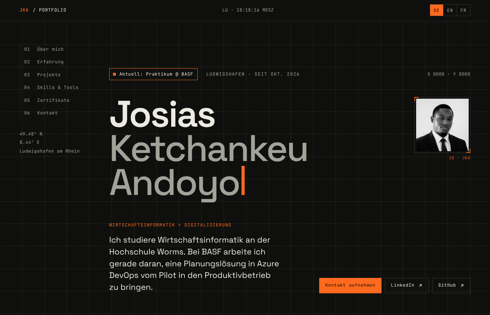

# Portfolio – Josias Ketchankeu Andoyo

Meine persönliche Portfolio-Webseite als Student der Wirtschaftsinformatik an der Hochschule Worms. Sie stellt meinen Werdegang, meine Projekte, Skills und Zertifikate vor, in drei Sprachen und ohne Framework.

**Online:** https://josiasketcha.github.io/



## Ziel

- Ein kompakter, gut lesbarer Überblick für Arbeitgeber und Hochschule
- Eine eigenständige Gestaltung im Cockpit-Stil: dunkler Hintergrund, eine einzige Akzentfarbe, Monospace-Details
- Reines **HTML, CSS und JavaScript**, ohne Framework und ohne Build-Schritt, direkt über GitHub Pages veröffentlicht

## Inhalt

| Nr. | Abschnitt | Inhalt |
|---|---|---|
| – | Start | Name, aktuelle Station, Kurzprofil, Porträt, Links zu LinkedIn und GitHub |
| 01 | Über mich | Studium, Schwerpunkte und Interessen |
| 02 | Erfahrung | Praktika und Tätigkeiten |
| 03 | Projekte | Studienprojekte mit Kontext, Ergebnis und Link zum Code |
| 04 | Skills & Tools | Gruppiert nach Daten & BI, Prozesse & Agile, Web & Entwicklung, Werkzeuge & Dokumentation |
| 05 | Zertifikate | Abgeschlossene Zertifikate mit Datum |
| 06 | Kontakt | E-Mail mit Kopieren-Knopf, LinkedIn und GitHub |

## Funktionen

| Funktion | Umsetzung |
|---|---|
| Drei Sprachen | Umschaltung DE / EN / FR ohne Neuladen; die Wahl wird im `localStorage` gespeichert |
| Seitennavigation | Seitliches Inhaltsverzeichnis, das den aktuell sichtbaren Abschnitt markiert (`IntersectionObserver`) |
| Uhr | Live-Uhrzeit für Ludwigshafen in der Zeitzone Europe/Berlin (`Intl.DateTimeFormat`) |
| Animationen | Terminal-Effekt beim Namen, Koordinatenanzeige der Maus im Startbereich, einlaufende Trennlinien |
| Projektgrafik | Interaktives SVG-Schema eines Radial-Convergences-Diagramms; ein Klick auf einen Knoten hebt dessen Verbindungen hervor |
| E-Mail kopieren | Kopiert die Adresse über die Clipboard API, mit Statusmeldung für Screenreader |
| Responsive | Breakpoints bei 1080, 860 und 560 px, vom Smartphone bis zum großen Bildschirm |
| Barrierearm | Link „Zum Inhalt springen“, ARIA-Beschriftungen, Tastaturbedienung; bei `prefers-reduced-motion` laufen keine Animationen |

## Projekt starten

Es wird nur ein Browser benötigt. Am einfachsten einen lokalen Webserver starten:

```bash
python -m http.server 8000
```

Danach **http://localhost:8000** öffnen. Ein Doppelklick auf `index.html` funktioniert ebenfalls.

## Texte ändern

- **Deutsch:** direkt in `index.html`.
- **Englisch und Französisch:** in `script.js` im Objekt `T` unter `en` bzw. `fr`.
  Jeder Text hat einen Schlüssel, der zum Attribut `data-i18n="…"` in `index.html` passt.

Beispiel: In `index.html` steht

```html
<h2 data-i18n="nav3">Projekte</h2>
```

und in `script.js` unter `T.en` der passende Eintrag `nav3:"Projects"`.

## Veröffentlichung

Die Seite wird über **GitHub Pages** aus dem Branch `main` veröffentlicht. Änderungen sind nach einem Push in ein bis zwei Minuten live.

## Dateistruktur

```
josiasketcha.github.io/
├── index.html          # Seitenstruktur und deutsche Texte
├── style.css           # Farben und Schriften in :root, Layout, responsive Regeln
├── script.js           # Sprachumschaltung (Objekt T), Uhr, Animationen, SVG-Schema, E-Mail kopieren
├── images/
│   └── portrait.jpg    # Profilfoto
├── docs/
│   └── screenshot.png
└── README.md
```

## Technik

- **HTML5** (semantische Abschnitte, ARIA)
- **CSS3** (Custom Properties, Grid, Media Queries)
- **JavaScript** ohne Bibliotheken (`IntersectionObserver`, `Intl`, Clipboard API, `localStorage`, SVG per DOM)
- Schriften **JetBrains Mono** und **Space Grotesk** über Google Fonts
- **GitHub Pages**

## Kontakt

**Josias Ketchankeu Andoyo** · [LinkedIn](https://www.linkedin.com/in/josias-ketchankeu-andoyo/) · [GitHub](https://github.com/JosiasKetcha)
